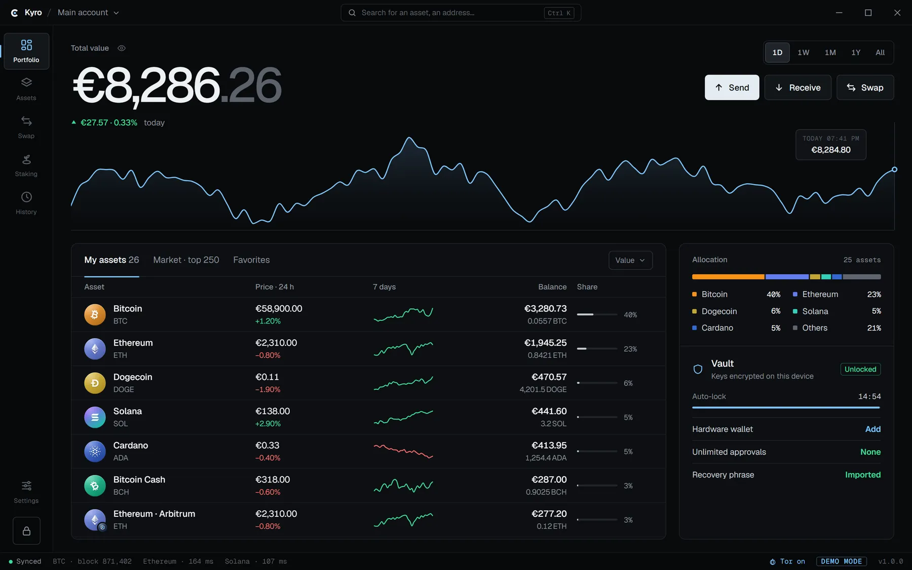
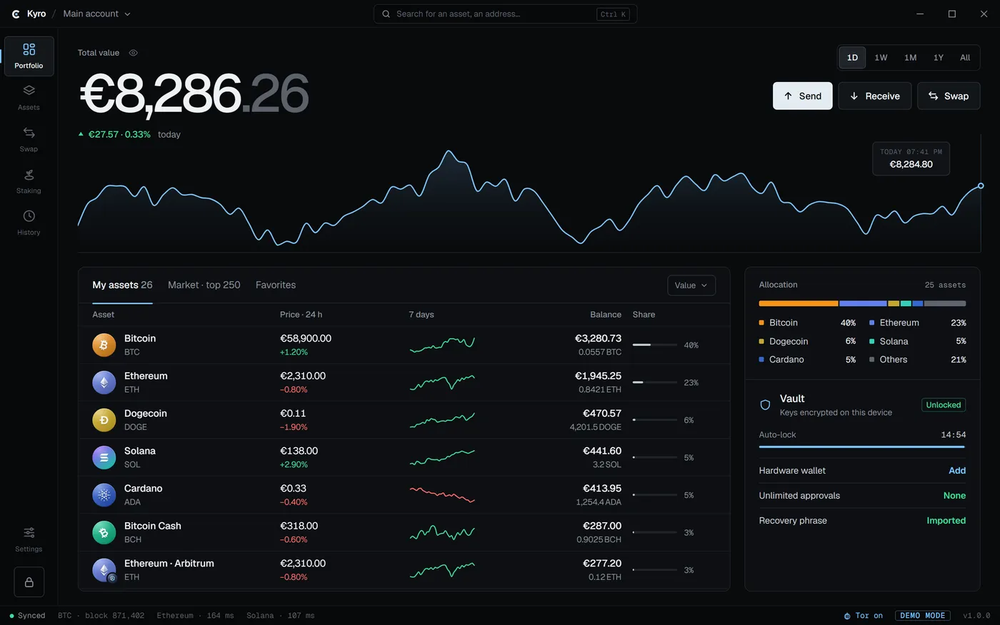
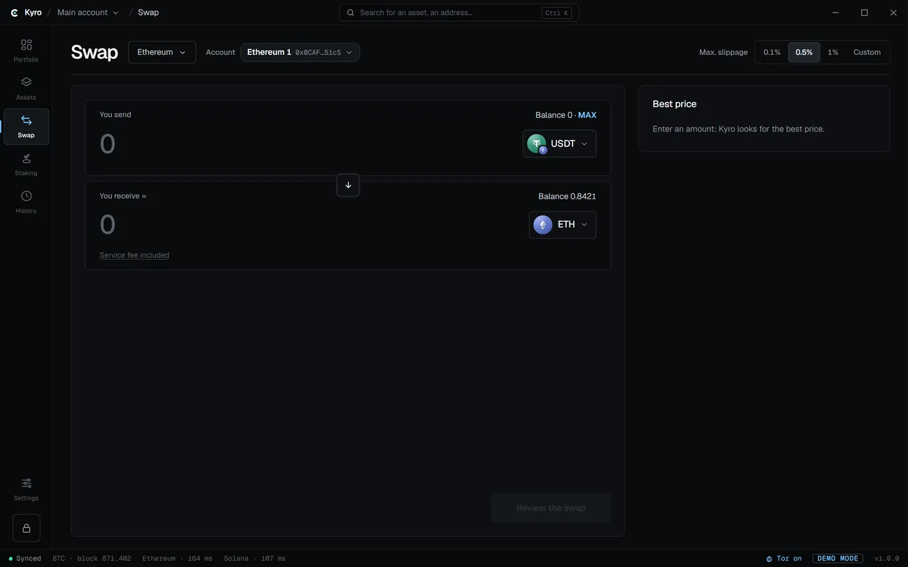
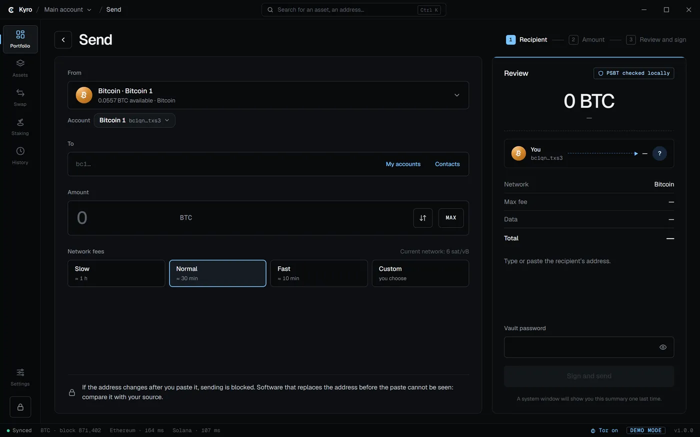
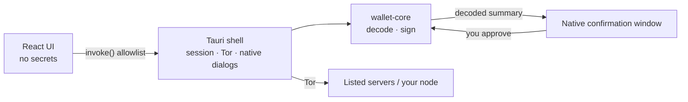

<p align="center">
  
</p>

<h1 align="center">Kyro Wallet</h1>

<p align="center">
  <b>A free, open-source, non-custodial desktop wallet.</b><br>
  One recovery phrase for 36 blockchains. Keys stay in the Rust core. Traffic goes over Tor.
</p>

<p align="center">
  <a href="LICENSE"></a>
  <a href="https://github.com/shuntraa/kyro-wallet/releases/latest"></a>
  
  
</p>

<p align="center">
  <a href="https://github.com/shuntraa/kyro-wallet/releases/latest"><b>Download</b></a> ·
  <a href="https://kyrowallet.com">Website</a> ·
  <a href="SECURITY.md">Security</a> ·
  <a href="https://github.com/shuntraa/kyro-wallet/security/advisories/new">Report a vulnerability</a>
</p>

<p align="center">
  
</p>

---

## What Kyro is

Kyro is a desktop wallet for Windows, macOS and Linux. You hold the keys: your recovery phrase is encrypted on your own computer, and nobody else — the developers included — can move your funds.

- **36 blockchains, one recovery phrase**, with **220+ tokens**.
- **Send, receive and swap** from the same window. Swaps carry a service fee from 0.7%, included in the rate — see [fees](https://kyrowallet.com/fees/).
- **Earn**: staking on SOL, ADA, TRX, NEAR, SUI and APT from accounts that stay in your name (SOL and ADA also from Ledger and Trezor, NEAR from Ledger), ETH liquid staking with Lido, and USDT, USDC, DAI and WETH lending on Aave v3. Rates are estimates.
- **Ledger and Trezor** hardware wallets on supported chains (see [below](#hardware-wallets)).
- **Simulation before signing** on EVM swaps and contract calls, through your own RPC node, no third-party service.
- **Several wallets** on one device, each with its own recovery phrase, password, accounts and history.
- **Watch addresses**: follow any public address or xpub with no key: balance, tokens and history, nothing signable.
- **Local alerts**: price levels and funds received, as system notifications, computed on your device.
- **Gains and losses**: average cost and unrealized gain per coin and in total, computed on your device. Where a price or an origin is unknown, Kyro shows « — » or says the figure is partial.
- **Fee choice, speed up and cancel**: Slow, Normal or Fast on Send, and a stuck Bitcoin, Litecoin or EVM send can be sped up or cancelled from History.
- **Automatic signed updates**, downloaded silently over Tor, signature-checked, applied at the next start.
- **Tor by default.** If Tor is unavailable, Kyro stops instead of silently connecting in the clear.
- **No account, no tracking, no analytics, no personal data.** Once a week Kyro anonymously downloads a tiny file over Tor so GitHub's download counter can estimate active wallets; turn it off in Settings › Privacy.
- Interface in **English and French**.

### Supported blockchains

| Group | Networks |
|---|---|
| **Bitcoin & UTXO** | Bitcoin, Litecoin, Dogecoin, Bitcoin Cash, Dash, Zcash (transparent addresses), Kaspa |
| **Ethereum & EVM** | Ethereum, BNB Chain, Polygon, Arbitrum, Optimism, Base, Avalanche, Cronos, Mantle, Sonic, Flare, Kaia, Gnosis, HyperEVM, Sei, Conflux |
| **Other networks** | Solana, TRON, Cardano, XRP Ledger, Stellar, NEAR, Sui, Monero, TON, Cosmos Hub, Polkadot, Aptos, Algorand |

Tokens include ERC-20 and other EVM standards, SPL (Solana), TRC-20 (TRON), Cardano native tokens and XRP Ledger issued currencies. Stablecoins are also supported on non-EVM chains: USDT on TON, USDC on Sui, USDC and USDT on Aptos, USDC on Stellar (the account needs a USDC trustline) USDC and USDT on NEAR, USDC and USDT on Algorand (after an opt-in) and USDT and USDC on Polkadot Asset Hub. TON's native coin is now named **Gram** (GRAM). Per-chain details: [kyrowallet.com/chains](https://kyrowallet.com/chains/).

## Why Kyro

**Keys never leave the Rust core.** The interface is a sandboxed web view that never sees a secret. Encryption, key derivation and signing happen in `wallet-core`, a pure Rust crate with no network and no file access. Private keys are derived for each signature, then wiped from memory.

**No blind signing.** Every signature needs your password *and* a confirmation in a native system window, drawn by the app shell rather than the web view. It shows what Rust itself decoded from the transaction, not what the interface claims. Unusual transactions get a second, reinforced confirmation.

**Private by default.** All traffic goes through an embedded Tor client, with a separate circuit per blockchain. Kyro contacts only the servers listed in [docs/NETWORK.md](docs/NETWORK.md), and you can point most chains at your own node.

**Scam protection built in.** Address-poisoning alerts, clipboard-tampering detection after a paste, refused invalid recipients, and exact ERC-20 approvals by default — an unlimited approval needs an explicit action and shows a warning.

**Swaps you can check.** Kyro decodes the provider's transaction before asking for your password and checks that it targets the provider's official contract. The fee is collected through each provider's official integrator-fee mechanism; Kyro never adds a separate transfer. Details: [docs/SWAP_FEES.md](docs/SWAP_FEES.md).

**Open and accountable.** GPL-3.0-or-later, dependencies pinned to exact versions, committed lockfiles, `cargo audit`, `cargo deny` and `pnpm audit` in CI, and a pinned Rust toolchain.

## Screenshots

| Portfolio | Swap | Send |
|:-:|:-:|:-:|
|  |  |  |

## Hardware wallets

Your keys stay in the device and every transaction is confirmed on its screen. Kyro still decodes the transaction in Rust, shows it in a native window, and verifies the device's signature before broadcasting.

| Device | Chains |
|---|---|
| **Ledger and Trezor** | Bitcoin, all EVM chains, Solana, Litecoin, Dogecoin, Bitcoin Cash, Dash, Stellar, Cardano (not the Trezor One) |
| **Ledger only** | XRP, TRON, Sui, Aptos, Algorand, Cosmos Hub, TON, NEAR |
| **Trezor only** | Zcash (transparent) |

Caveats: on NEAR and TON the Ledger account is a different account than the software wallet for the same phrase. Not available on hardware wallets: Monero, Polkadot, Kaspa. From a hardware account, token sends are supported on EVM chains, Solana (SPL), TRON (TRC-20, Ledger), TON (USD₮, Ledger), Stellar (USDC, Ledger and Trezor), Sui (USDC, Ledger), Aptos (USDC, USDt, Ledger), Algorand (USDC, USDt, Ledger) and NEAR (USDC, USDt, Ledger) for now (native coins elsewhere). Details in [SECURITY.md](SECURITY.md).

## Automatic updates

Kyro checks for updates over Tor and downloads them silently in the background. Each update is signed; the signature is verified against the public key built into the app before anything is installed, and a bad signature is rejected. The update is installed when you quit Kyro or at the next start, never in the middle of a session.

## Security model

| Layer | Holds | Role |
|---|---|---|
| React interface (web view) | No secrets | Calls an allowlist of Tauri commands. Strict CSP, no remote scripts, no direct network or file access. |
| Tauri shell (Rust) | Session | Auto-lock, filtered network access over Tor, native confirmation windows. |
| `wallet-core` (pure Rust) | Encrypted vault | Encrypts (Argon2id + XChaCha20-Poly1305), derives, decodes, signs. No network, no files. |

The recovery phrase is only ever displayed in a native window opened by Rust, never in the interface. A compromised interface still cannot sign without your password and the native window.

**Audit status:** an internal security review has been done; no independent external audit has been published yet. Like all GPL software, Kyro comes with no warranty. What Kyro protects against — and what no software can — is described in [SECURITY.md](SECURITY.md), including a per-chain threat model.

## Architecture at a glance

```
kyro-wallet/
├─ crates/wallet-core/     Pure Rust: vault, BIP39/32, derivation, decoding, signing
├─ apps/desktop/
│  ├─ src-tauri/           Tauri 2 shell: IPC commands, session + auto-lock, filtered net_fetch, native dialogs
│  └─ src/                 React + strict TypeScript interface (no secrets)
├─ packages/
│  ├─ shared/              IPC contract types
│  ├─ chains/              Chain adapters (build unsigned transactions)
│  ├─ market/              Prices and charts (CoinGecko)
│  └─ swap/                Swap providers and fee logic
└─ docs/                   ARCHITECTURE, IPC, NETWORK, SWAP_FEES
```



TypeScript builds unsigned transactions and broadcasts signed ones; Rust decodes what will actually be signed and shows it to you. TypeScript can be wrong or compromised without being able to redirect funds. More in [docs/ARCHITECTURE.md](docs/ARCHITECTURE.md) and [docs/IPC.md](docs/IPC.md).

## Download & verify

Kyro is published **only** on [GitHub Releases](https://github.com/shuntraa/kyro-wallet/releases/latest). There is no mobile app; anything in an app store using the name is not ours.

### One-line install (recommended)

**Windows** (PowerShell):

```powershell
irm https://kyrowallet.com/install.ps1 | iex
```

**macOS and Linux** (Terminal):

```bash
curl -fsSL https://kyrowallet.com/install.sh | sh
```

The script downloads the latest release from GitHub, checks its SHA-256 against `SHA256SUMS` (it stops if they differ), then installs it: the normal installer window on Windows, `Kyro.app` in `/Applications` (or `~/Applications`) on macOS, `~/.local/bin/kyro` with a menu entry on Linux x86_64. Nothing is sent about you, no sudo. Files fetched by PowerShell or curl are not marked as downloaded from the internet, so SmartScreen and Gatekeeper do not block the first launch. Both scripts are short and open source: read them first in [`website/src/install.ps1`](website/src/install.ps1) and [`website/src/install.sh`](website/src/install.sh).

### Or download the file

| Platform | File |
|---|---|
| Windows | [Kyro-windows-x64-setup.exe](https://github.com/shuntraa/kyro-wallet/releases/latest/download/Kyro-windows-x64-setup.exe) · [.msi](https://github.com/shuntraa/kyro-wallet/releases/latest/download/Kyro-windows-x64.msi) |
| macOS (Apple Silicon & Intel) | [Kyro-macos.dmg](https://github.com/shuntraa/kyro-wallet/releases/latest/download/Kyro-macos.dmg) |
| Linux | [AppImage](https://github.com/shuntraa/kyro-wallet/releases/latest/download/Kyro-linux-x86_64.AppImage) · [.deb](https://github.com/shuntraa/kyro-wallet/releases/latest/download/Kyro-linux-amd64.deb) |

### 1. Verify the download

Download [SHA256SUMS](https://github.com/shuntraa/kyro-wallet/releases/latest/download/SHA256SUMS) next to the installer and compare:

```bash
Get-FileHash .\Kyro-windows-x64-setup.exe -Algorithm SHA256   # Windows (PowerShell)
shasum -a 256 Kyro-macos.dmg                                  # macOS
sha256sum -c SHA256SUMS --ignore-missing                      # Linux
```

If the hashes differ, delete the file and download it again. The installers are not code-signed yet, so your OS warns you on first launch: always verify the checksum before you click through that warning.

### 2. Install

**Windows**

1. Download `Kyro-windows-x64-setup.exe` (recommended: it is the only Windows package that updates itself; the `.msi` does not).
2. Run it. SmartScreen shows "Windows protected your PC": click **More info → Run anyway**.
3. Kyro appears in the Start menu.

**macOS** (one universal `.dmg` for Apple Silicon and Intel)

1. Open `Kyro-macos.dmg` and drag **Kyro** to **Applications**.
2. First launch: Gatekeeper blocks the app. Right-click Kyro in Applications → **Open**, or go to *System Settings → Privacy & Security → Open Anyway*.
3. The installed app updates itself.

**Linux**

- **AppImage** (recommended, updates itself):

  ```bash
  chmod +x Kyro-linux-x86_64.AppImage && ./Kyro-linux-x86_64.AppImage
  ```

  AppImages need FUSE 2, which recent Ubuntu releases no longer install by default: `sudo apt install libfuse2` (Ubuntu 22.04) or `sudo apt install libfuse2t64` (Ubuntu 24.04 and later).
- **Debian / Ubuntu `.deb`**: `sudo apt install ./Kyro-linux-amd64.deb`. It does not update itself: install the new `.deb` to update.
- **Hardware wallets on Linux** need udev rules so that Kyro can open the device:
  - Ledger: [LedgerHQ/udev-rules](https://github.com/LedgerHQ/udev-rules) (official rules and `add_udev_rules.sh`).
  - Trezor: [official udev rules](https://trezor.io/learn/a/udev-rules) (`trezor-udev` rules file and instructions).

## Build from source

Requirements: [Rust](https://rustup.rs) **1.97.1** (pinned in `rust-toolchain.toml`; rustup installs it automatically), Node.js 22+, pnpm 11 (`corepack enable`), and the [Tauri prerequisites](https://v2.tauri.app/start/prerequisites/) for your OS.

```bash
git clone https://github.com/shuntraa/kyro-wallet.git
cd kyro-wallet
pnpm install --frozen-lockfile
pnpm dev        # run the app in development mode
pnpm build      # build the installers
```

### Tests and checks

```bash
pnpm test       # TypeScript tests in every package + cargo test --workspace
pnpm typecheck  # TypeScript, every package
pnpm lint       # ESLint + cargo clippy (warnings are errors)
pnpm audit      # pnpm audit --prod + cargo audit
```

## Contributing

Issues and pull requests are welcome. Before opening a PR, run `pnpm lint`, `pnpm typecheck` and `pnpm test`. Any new server Kyro contacts must be listed in [docs/NETWORK.md](docs/NETWORK.md), and changes to the IPC contract belong in [docs/IPC.md](docs/IPC.md).

**Never post a recovery phrase, private key or password** in an issue, pull request or log.

## Reporting a vulnerability

Please do **not** open a public issue. Report privately to security@kyrowallet.com or through [GitHub security advisories](https://github.com/shuntraa/kyro-wallet/security/advisories/new) (*Security → Report a vulnerability*), with a proof of concept if possible. Reports are acknowledged within 72 hours, with a fix and coordinated disclosure within 90 days at most. See [SECURITY.md](SECURITY.md).

## Support the project

Kyro is free. If you'd like to help keep it going:

- **GitHub Sponsors:** [github.com/sponsors/shuntraa](https://github.com/sponsors/shuntraa)

| Network | Address |
|---|---|
| Bitcoin | `bc1qta8efdy72ge9qy8yj8s0ckwar0lg44ggwnaard` |
| Ethereum & EVM chains | `0x86cD9af8067fF5e0001c709a550cD62b5e968B44` |
| Solana | `ptsbLdrhmEfC2eQ9gj4aieF4irdhQqYzK1fdNwHBZcM` |
| Litecoin | `LWePW8iwa8RxxYB6av4KBriBNkRgLWvNyw` |
| Dogecoin | `DKCSjtypvD9qg3R175YdijmwvKh5FnAU14` |
| TRON | `TT9j25bsbBAgxCDEXTN1cpjcD54Jz51pES` |
| Cardano | `addr1qy9d3jctafj2cgfm8sgllfjkrxrgxn9mz9dy0qzxuwscx6c2mr9sh6ny4ssnk0q3l7n9vxvxsdxtky26g7qydcapsd4sux3dj3` |

## License

Kyro Wallet is free software, released under the [GNU General Public License v3.0 or later](LICENSE).
